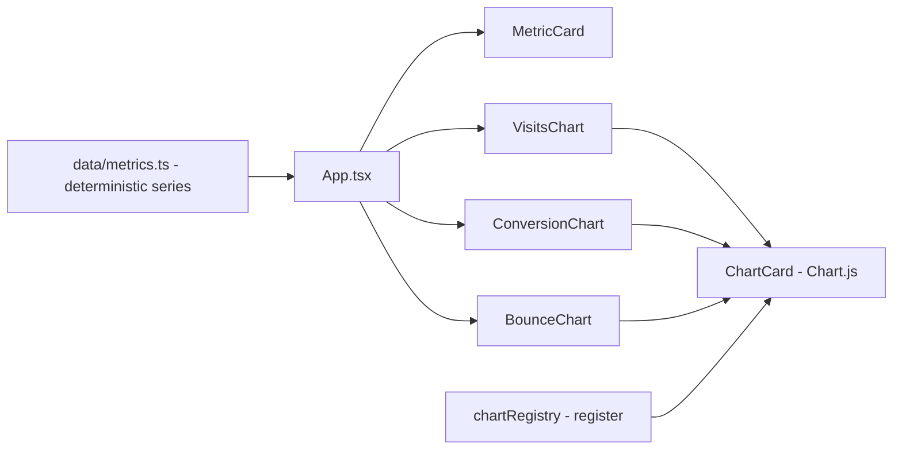

# dashboard-metricas-site

**English** · [Português (Brasil)](README.md)

     

## What it is

**A website metrics dashboard**: a **React 18 + TypeScript SPA** with **Chart.js** charts (via `react-chartjs-2`) for visits, conversions and bounce. The data is **synthetic and deterministic** (fixed epoch 2026-01-01, no `Math.random()`), which makes tests and demos reproducible. It is an educational visualisation lab.

## Status

A working prototype; **13 tests passing** and a confirmed production build (~105 kB gzip).

## Features

- **Metric cards** (`MetricCard.tsx`): a summary per indicator.
- **Charts** (`VisitsChart.tsx`, `ConversionChart.tsx`, `BounceChart.tsx`): time series with `ChartCard` as the frame.
- **Chart.js registration** (`lib/chartRegistry.ts`): registers the ESM build's scales/controllers (required in both the app and the tests).
- **Utilities** (`lib/chartUtils.ts`): series-formatting helpers.
- **Data** (`data/metrics.ts`): deterministic synthetic series — everything derives from a fixed seed + index, dates with a fixed epoch, values rounded to 2 decimals.

## Architecture

A React SPA (Vite). `App.tsx` composes the `ChartCard`s; data comes from `data/metrics.ts` (swappable for an API); Chart.js is registered once via `chartRegistry`.



## Stack

- React 18.3, TypeScript ~5.6
- Chart.js 4.4 + react-chartjs-2 5.3
- Vite 5.4, Vitest 2.1

## Repository layout

```
dashboard-metricas-site/
├── src/
│   ├── components/      # MetricCard, ChartCard, Visits/Conversion/BounceChart
│   ├── data/metrics.ts  # deterministic synthetic series
│   ├── lib/             # chartRegistry, chartUtils
│   └── App.tsx · main.tsx · types.ts
├── test/                # 3 suites (13 tests)
├── index.html · vite.config.ts
└── package.json
```

## Prerequisites and installation

Node.js ≥ 18.

```bash
npm install
```

## How to run

```bash
npm run dev        # dev server
npm run build      # production build (tsc + vite)
npm run preview    # serve the build
```

## Tests and quality

Real commands (verified by the agent):

```bash
npm test
# Test Files  3 passed · Tests  13 passed (13)

npm run build
# ✓ built in ~2s (bundle ~311 kB, ~105 kB gzip)
```

## Technical decisions and trade-offs

- **Deterministic data** (fixed epoch, no Math.random): stable tests and screenshots; the trade-off is needing an API for real data.
- **Explicit chartRegistry**: Chart.js in ESM does not auto-register controllers/scales — registering manually avoids surprises in build and tests.

## Known limitations and roadmap

- Data is fixed in `data/metrics.ts` (no analytics backend/API).
- Line charts only (no bar/doughnut by default).

## Development process

An individual project by Kelvin Oliveira, built with orchestrated AI agents and reviewed by the author.

## License and author

MIT — Copyright (c) 2026 Kelvin Oliveira. Author: [Kelvin Oliveira](https://github.com/KelvinOliveiraCode) · [Portfolio](https://kelvinoliveiracode.github.io/portfolio/)
