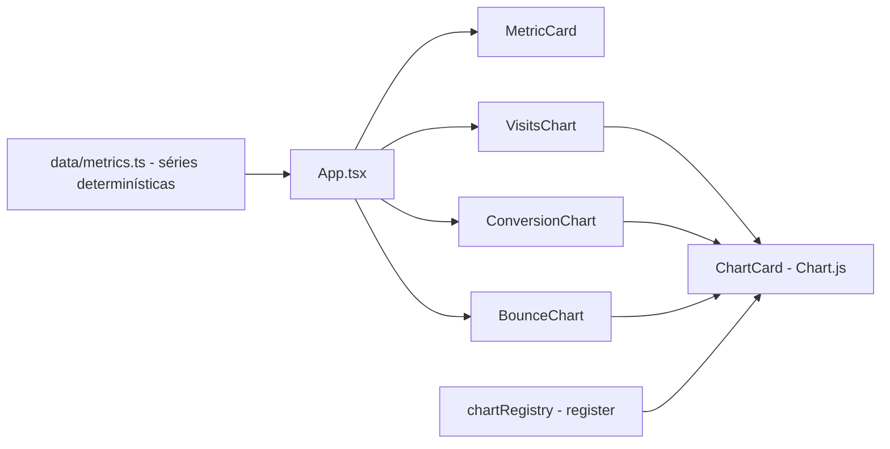

# dashboard-metricas-site

[English](README.en.md) · **Português (Brasil)**

     

## O que é

**Dashboard de métricas de site**: uma **SPA em React 18 + TypeScript** com gráficos **Chart.js** (via `react-chartjs-2`) para visitas, conversões e bounce. Os dados são **sintéticos e determinísticos** (época fixa 2026-01-01, sem `Math.random()`), o que torna testes e demos reprodutíveis. É um laboratório educacional de visualização.

## Status

Protótipo funcional; **13 testes passando** e build de produção confirmado (~105 kB gzip).

## Funcionalidades

- **Cartões de métrica** (`MetricCard.tsx`): resumo por indicador.
- **Gráficos** (`VisitsChart.tsx`, `ConversionChart.tsx`, `BounceChart.tsx`): séries temporais com `ChartCard` como moldura.
- **Registro do Chart.js** (`lib/chartRegistry.ts`): registra escalas/controllers do build ESM (necessário na app e nos testes).
- **Utilitários** (`lib/chartUtils.ts`): helpers de formatação das séries.
- **Dados** (`data/metrics.ts`): séries sintéticas determinísticas — tudo deriva de semente fixa + índice, datas com época fixa, valores a 2 casas.

## Arquitetura

SPA React (Vite). `App.tsx` compõe os `ChartCard`s; os dados vêm de `data/metrics.ts` (trocáveis por uma API); o Chart.js é registrado uma vez via `chartRegistry`.



## Stack

- React 18.3, TypeScript ~5.6
- Chart.js 4.4 + react-chartjs-2 5.3
- Vite 5.4, Vitest 2.1

## Estrutura do repositório

```
dashboard-metricas-site/
├── src/
│   ├── components/      # MetricCard, ChartCard, Visits/Conversion/BounceChart
│   ├── data/metrics.ts  # séries sintéticas determinísticas
│   ├── lib/             # chartRegistry, chartUtils
│   └── App.tsx · main.tsx · types.ts
├── test/                # 3 suítes (13 testes)
├── index.html · vite.config.ts
└── package.json
```

## Pré-requisitos e instalação

Node.js ≥ 18.

```bash
npm install
```

## Como executar

```bash
npm run dev        # dev server
npm run build      # build de produção (tsc + vite)
npm run preview    # serve o build
```

## Testes e qualidade

Comandos reais (verificados pelo agente):

```bash
npm test
# Test Files  3 passed · Tests  13 passed (13)

npm run build
# ✓ built in ~2s (bundle ~311 kB, ~105 kB gzip)
```

## Decisões técnicas e trade-offs

- **Dados determinísticos** (época fixa, sem Math.random): testes e screenshots estáveis; em troca, precisa de API para dados reais.
- **chartRegistry explícito**: o Chart.js em ESM não auto-registra controllers/escalas — registrar manualmente evita surpresas em build e teste.

## Limitações conhecidas e roadmap

- Dados fixos em `data/metrics.ts` (sem backend/API de analytics).
- Apenas gráficos de linha (sem barras/rosca por padrão).

## Processo de desenvolvimento

Projeto individual de Kelvin Oliveira, construído com agentes de IA orquestrados e revisado pelo autor.

## Licença e autor

MIT — Copyright (c) 2026 Kelvin Oliveira. Autor: [Kelvin Oliveira](https://github.com/KelvinOliveiraCode) · [Portfólio](https://kelvinoliveiracode.github.io/portfolio/)
